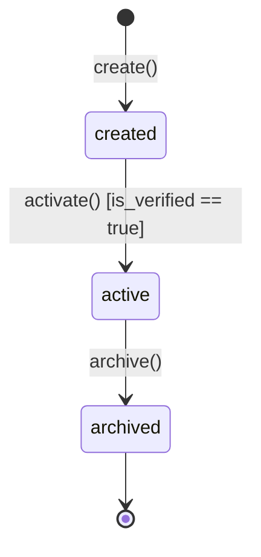

# <Entity or Functionality Name>

<One or two sentences defining what `<EntityName>` IS (from `GLOSSARY.md`) and where it lives in the codebase.>

## 1. Schema and Field Invariants

| Field | Type | Mutability | Invariant / Constraint |
|---|---|---|---|
| `id` | `UUIDv7` | Immutable | Non-null, unique primary key generated at creation. |
| `status` | `StatusEnum` | Mutable | Must follow the state transition matrix in Section 2. |
| `created_at` | `int64` | Immutable | Unix epoch milliseconds in UTC; `> 0`. |

## 2. Lifecycle and State Transitions

| Current State | Event / Method | Guard Condition | Next State | Side Effects |
|---|---|---|---|---|
| `created` | `activate()` | `is_verified == true` | `active` | Sets `activated_at = now()`. |
| `active` | `archive()` | None | `archived` | Revokes active leases. |

**Forbidden transitions:** Any transition not listed in the table raises `InvalidStateTransitionError`. Specifically, `archived` is a terminal state and cannot transition back to `active`.

## 3. Minute Behavioral Details

- **Serialization format:** <Exact JSON/wire/SQLite representation, field casing, and null handling.>
- **Equality and identity:** <Two instances are equal if and only if `a.id == b.id`.>
- **Boundary and degenerate inputs:**
  - <Exact behavior on zero, negative, empty, maximum size, or malformed inputs.>
- **Cleanup and retention:** <When and how records or memory for this entity are freed or deleted.>
