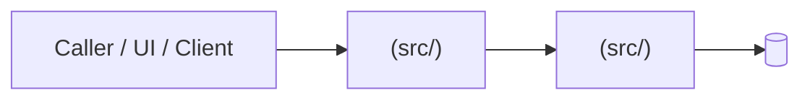
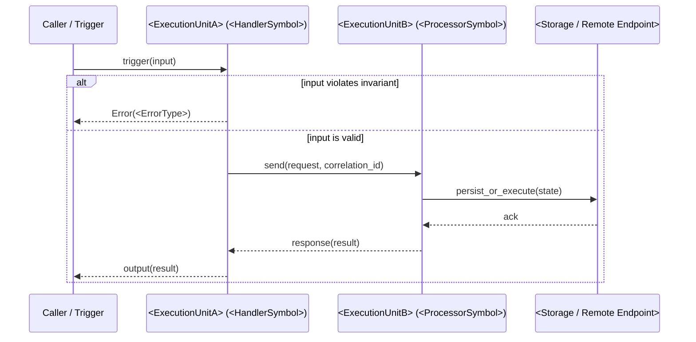
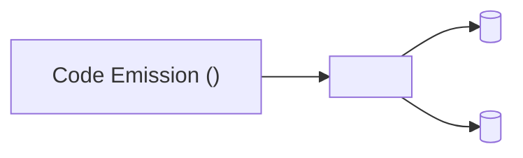

# High-Level Design

<One or two sentences stating what the system is, who interacts with it, and its primary output.>

## 1. System Boundaries and Non-Goals

### In Scope
- <Concrete capability 1 with entry point>
- <Concrete capability 2 with entry point>

### Out of Scope (Deliberate Non-Goals)
- <What the system refuses to do and which external component owns it instead>

## 2. Runtime & Execution Topology

Map the actual execution units of this codebase (e.g., UI process + local background daemon + remote server, CLI binary, mobile client + API, serverless functions, or service instances) and the channels connecting them.

> For dense topologies (> 20 edges) or interactive layer filtering, link the standalone HTML view: `[Runtime Topology Inspector](./visualizations/runtime-topology.html)`.

| Execution Unit | Code Entrypoint | Boundary / Channel | Lifecycle & State Ownership | LLD Link |
|---|---|---|---|---|
| `<UnitA>` (e.g., Frontend / CLI / Handler) | `src/<path_a>` | `<UI event / CLI args / IPC / HTTP>` | `<Stateless / In-memory session / Single-instance>` | [modules/<mod_a>/lld.md](./modules/<mod_a>/lld.md) |
| `<UnitB>` (e.g., Daemon / Worker / Service) | `src/<path_b>` | `<Unix socket / gRPC / Queue>` | `<Owns local SQLite / Shared DB / Background loop>` | [modules/<mod_b>/lld.md](./modules/<mod_b>/lld.md) |

## 3. End-to-End Call Flows Across Boundaries

### Flow 1: <Primary Flow Across Execution Units>

1. **Entry at `<ExecutionUnitA>`:** `<Caller>` triggers `<HandlerSymbol>` (`src/<path_a>`), which validates `<input>` against `<Invariant>`.
2. **Cross-boundary hop (`<ExecutionUnitA>` → `<ExecutionUnitB>`):** `<HandlerSymbol>` sends `<request>` with `<correlation_id>` over `<Channel>` (timeout: `<N ms>`, retry/fallback policy: `<policy>`).
3. **Execution & persistence in `<ExecutionUnitB>`:** `<ProcessorSymbol>` (`src/<path_b>`) updates `<Storage>` and returns `<Result>`.

## 4. Telemetry & Log Lineage (Sources → Transport → Sinks)

| Telemetry Stream | Emission Source (`file:symbol`) | Transport & Buffering | Target Sink & Retention | Failure / Offline Policy |
|---|---|---|---|---|
| Structured Logs | `<Logger.info / error>` (`src/<obs_path>`) | `<stdout / IPC / rotating file writer>` | `<Local file path / OS log / Remote sink>` | `<Rotate at N MB / Ring-buffer / Drop oldest>` |
| Metrics / Timers | `<Metrics.record>` (`src/<obs_path>`) | `<In-memory aggregation / push / pull>` | `<Local diagnostics / Remote sink>` | `<Best-effort non-blocking>` |
| Audit / Crash Records | `<AuditOrCrashWriter>` (`src/<obs_path>`) | `<Synchronous disk write / transactional>` | `<Local crash dir / DB table>` | `<Flush before exit / Fail-closed>` |

- **Correlation propagation:** Every operation attaches `<correlation_id / trace_id / session_id>` at the entry boundary and forwards it across thread, IPC, queue, and network hops.
- **Redaction invariant:** `<Logger>` strips `<tokens, credentials, secrets, PII>` before writing to any transport or sink.

## 5. Cross-Cutting Invariants & Trust Boundaries

- **<Boundary Name> (`<source_path>`):** Validates all untrusted input (user input, IPC payloads, network responses, disk files) before passing typed structures to domain modules.
- **<Failure Domain>:** If `<ExecutionUnitB or Remote Server>` is unreachable, `<ExecutionUnitA>` transitions to `<degraded/offline/error state>` within `<N> ms` without corrupting `<State>`.
