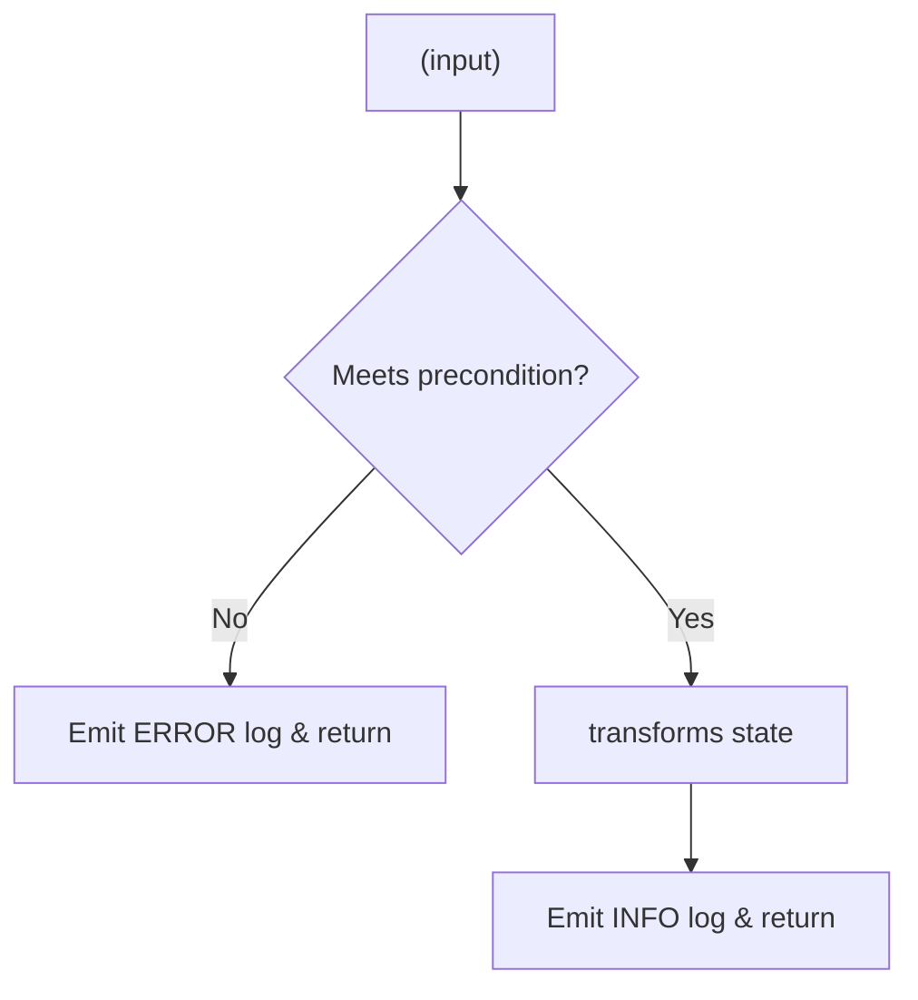

# <Module Name> Low-Level Design

<One or two sentences defining what `src/<module>/` owns, which execution unit runs it, and which upstream/downstream boundaries it connects.>

## 1. Public Interface Contract

### `<function_or_method_signature>`
- **Source:** `src/<module>/<file>.ext`
- **Execution context:** Runs inside `<ExecutionUnit>` (e.g., UI thread, background daemon, CLI process, or service worker) when invoked by `<UpstreamCaller>`.
- **Preconditions:** <What must be true about inputs and state before calling.>
- **Postconditions:** <What is guaranteed about the return value and side effects.>
- **Errors:**
  - Raises/returns `<ErrorTypeA>` when <exact condition>.
  - Raises/returns `<ErrorTypeB>` when <exact condition>.

## 2. Internal Execution Flow

1. `<Step 1 actor and action in active voice.>`
2. `<Step 2 actor and action in active voice.>`
3. `<Step 3 actor and action in active voice.>`

> If the algorithm involves complex multi-step state mutations, buffer indexing, or concurrency interleavings, link an interactive HTML stepper: `[<Module> Execution Stepper](./visualizations/<module>-stepper.html)`.

## 3. State, Concurrency, and Resource Rules

- **State ownership:** <Which struct, file, or table holds state; whether the module is stateless or stateful.>
- **Concurrency:** <Thread-safety guarantees, event-loop/thread affinity, locks held, or single-threaded assumptions.>
- **Idempotency:** <What happens when the same operation runs twice with identical inputs.>

## 4. Telemetry & Logs Emitted (Sources → Sinks)

| Event / Metric Name | Level / Kind | Source (`file:symbol`) | Trigger Condition | Mandatory Fields | Target Sink |
|---|---|---|---|---|---|
| `<module.action.completed>` | Log `INFO` | `src/<module>/<file>.ext:<fn>` | Operation succeeds | `<correlation_id>`, `<entity_id>`, `duration_ms` | `<Target Sink>` |
| `<module.action.failed>` | Log `ERROR` | `src/<module>/<file>.ext:<fn>` | Validation or boundary I/O fails | `<correlation_id>`, `error_code`, `retryable` | `<Target Sink>` |
| `<module_operation_count>` | Counter / Timer | `src/<module>/<file>.ext:<fn>` | Every invocation | `status` (`ok`\|`err`) | `<Target Sink>` |

## 5. Behavioral Edge Cases and Failure Modes

| Scenario / Input Boundary | Code Location | Exact Behavior & Emitted Telemetry |
|---|---|---|
| Empty input (`[]` or `""`) | `src/<module>/<file>.ext` | Returns `[]` immediately without I/O; emits no error log. |
| Limit boundary (`N == MAX_LIMIT`) | `src/<module>/<file>.ext` | Accepts `N` (`<=` comparison); rejects `N + 1` with `<ErrorType>` and logs `<module.limit_exceeded>` (`WARN`). |
| Partial write / crash / disconnect mid-run | `src/<module>/<file>.ext` | Rolls back or cleans up scratch state; leaves previous state intact; logs `<module.aborted>`. |

## 6. Entities Owned by This Module

- [`<EntityName>`](./entities/<entity-slug>.md) — <One-sentence summary of the entity.>
