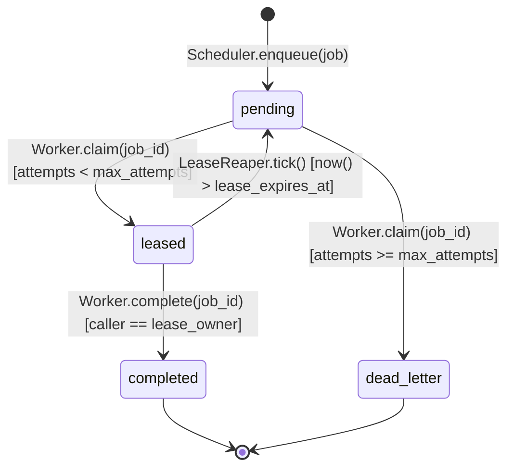

# Visualizations in Documentation: Mermaid Diagrams & Standalone HTML Files

A diagram in `sane-docs` is not decorative artwork. It is a **visual behavioral contract**. Every node, arrow, state, and step must correspond to a real module, symbol, state value, or wire field in the codebase.

---

## 1. When a Visualization Is Required

Do not wait for the user to ask for a diagram. Include a visualization whenever the behavior being documented involves:

1. **Multi-hop data or control flow** (≥ 3 components, functions, or queues exchanging data).
2. **State machines and entity lifecycles** (≥ 3 states or any loop/retry/dead-letter transition).
3. **Concurrency, locking, or protocol handshakes** (2+ actors interacting over time with race or timeout boundaries).
4. **Data schemas, ASTs, or binary/memory layouts** (parent-child containment, foreign keys, or byte offsets).
5. **Architectural boundaries and trust zones** (showing which modules may call which, and where validation gates sit).

---

## 2. Routing: Fenced Mermaid vs. Standalone HTML File

Choose the simplest representation that preserves complete behavioral truth:

### Use Fenced Mermaid (` ```mermaid `) When:
- The diagram is static and has **≤ 20 nodes or arrows**.
- It fits cleanly inline inside `hld.md`, `lld.md`, `entities/<entity>.md`, `concepts/<topic>.md`, or an ADR.
- Standard Mermaid primitives express the exact semantics:
  - `flowchart LR` / `flowchart TD` — System topology, module dependency rules, decision trees, pipeline stages.
  - `sequenceDiagram` — Request lifecycles, lock acquisition/release, retry/timeout sequences across actors.
  - `stateDiagram-v2` — Entity state machines with `[guard]` conditions and terminal error states.
  - `erDiagram` / `classDiagram` — Database tables, foreign keys, and domain type hierarchies.

### Use a Standalone HTML File (`visualizations/<slug>.html`) When:
- **Scale exceeds static readability:** The graph has **> 20 nodes or edges**, cross-cutting layers, or requires search, filtering by subsystem, or click-to-inspect details.
- **Temporal or algorithmic stepping matters:** A reader understands the behavior much faster by stepping forward/backward through an algorithm (e.g., ring-buffer wrap-around, B-tree split, Raft log replication, token-bucket refill, DAG scheduler tick) and watching state variables mutate at each step.
- **Spatial / byte / memory layout:** Visualizing frame headers, tensor tiling, cache lines, or UI viewport regions where exact spatial coordinates and hover/click inspection carry the spec.
- **Multi-dimensional comparisons:** Interactive latency/throughput trade-off explorers or benchmark comparisons.

---

## 3. Rules for Mermaid Diagrams

1. **Use exact codebase identifiers and canonical glossary terms.**
   - Bad node label: `[Auth Service] --> [Token Checker]`
   - Good node label: `AuthMiddleware["AuthMiddleware (src/auth/middleware.ts)"] --> TokenVerifier["TokenVerifier.verify()"]`
2. **Label every arrow with the trigger, method call, or data payload, plus `[guard]` conditions.**
   - Bad arrow: `A --> B`
   - Good arrow: `Pending --> Leased : Worker.claim(job_id) [attempts < max_attempts]`
3. **Always draw failure and rejection paths.**
   - A diagram that shows only the `200 OK` path hides half the behavioral contract. Include timeout, validation failure, rollback, and dead-letter branches.
4. **Cap complexity at ≤ 20 arrows per diagram.**
   - If a Mermaid diagram needs more than 20 arrows, either split it into a high-level overview (`hld.md`) plus per-module diagrams (`lld.md`), or promote it to an interactive `.html` visualization.

### Example: Behavioral State Diagram (`stateDiagram-v2`)



---

## 4. Rules for Standalone HTML Visualizations

Start from [assets/visualization-template.html](../assets/visualization-template.html) and customize it for the target subsystem, state machine, or algorithm.

1. **Single self-contained `.html` file, zero external dependencies.**
   - Embed all HTML, CSS, SVG, and JavaScript in one file.
   - Never load external scripts, stylesheets, fonts, or images from CDNs (`https://...`). The file must work offline when opened directly from disk (`file://`) or previewed in an IDE.
2. **Include the `sane-docs-contract` header comment at the top of the `.html` file.**
   - `scripts/verify_docs.py` parses this block to verify that `code_paths` and `symbols` exist and that `sync_commit` has not drifted:
     ```html
     <!-- sane-docs-contract
     title: Lease Lifecycle and Reaper Stepper
     doc_type: visualization
     status: active
     sync_commit: a1b2c3d
     code_paths:
       - src/scheduler/lease.py
     symbols:
       - Lease
       - LeaseReaper
     -->
     ```
3. **Useful on first paint, interactive for deep drill-down.**
   - The initial render must immediately show the system topology, state graph, or step 1 of the flow without requiring setup.
   - Selecting a node, edge, or step must display its **exact code anchor** (`file:symbol`), **preconditions/invariants**, **state mutations**, and **edge-case behavior**.
4. **Theme-aware and accessible.**
   - Support both light and dark modes via CSS custom properties (`@media (prefers-color-scheme: dark)`).
   - Provide keyboard navigation (e.g., `ArrowLeft` / `ArrowRight` for step-through timelines) and semantic `aria-label` attributes on SVG diagrams and controls.
5. **Cross-linked in Markdown and `INDEX.md`.**
   - Link the `.html` file from the Markdown document it supports (`See the interactive [<Title>](./visualizations/<slug>.html)`) and list it in the directory's `INDEX.md` table. (See [assets/visualization-template.html](../assets/visualization-template.html) for a working example of the Lease Lifecycle Inspector.)
